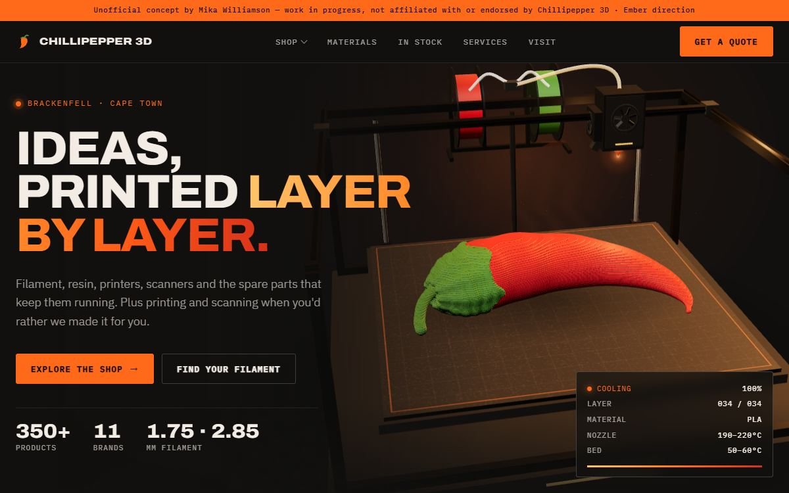

# Concept sites

Unofficial website concepts for small businesses, by **Mika Williamson**.

> **Work in progress.** Still changing, and not yet signed off by the owners. These are not the real websites. They are not affiliated with, endorsed by or approved by Chillipepper 3D, Grapevine Church or Fire & Co. Every page says so in a banner at the top and carries a `noindex` tag.

I like picking a real small business, looking hard at how it shows up online, and asking "what if this felt like the thing it actually is?" Then I build that, quickly, so the owner can see it. Three folders, three businesses, three "what if" builds.

| Concept | What I explored | Open |
|---|---|---|
| **Chillipepper 3D** (filament and 3D printing shop) | Six design directions of one shop on one page, plus a switcher to compare them. Lead direction: a chilli that prints itself in WebGL. | [`chillipepper/`](chillipepper/index.html) |
| **Grapevine Church** (a community church) | One calm, readable page, and a logo that builds itself on load. | [`grapevine/`](grapevine/index.html) |
| **Fire & Co** (open-fire catering) | A dark, cinematic take with canvas embers and a booking picker that writes your enquiry as you choose. | [`fire-and-co/`](fire-and-co/index.html) |

There is a gallery at [`index.html`](index.html). Open it from a file, or on GitHub Pages once it is switched on. Every path is relative, so both work. The pages load Three.js, GSAP and Google Fonts from public CDNs, so be online.

## Chillipepper 3D: one shop, six moods

**The idea.** Chillipepper 3D is a filament and 3D printing shop (it is also where I buy my own filament). I kept the same real content in every version (the six shop categories, six materials, the in-stock list and the services) and changed everything around it: type, colour, layout rhythm and the hero animation. The question was "what does a shop about making things layer by layer feel like?" and the answer changes with the direction.

- **Atelier, Greenhouse, Spice** are the first three directions, with serif display type.
- **Blueprint** is a paper-white technical drawing. The hero is a hand-built SVG that goes from line drawing to printed chilli as you scroll (GSAP ScrollTrigger pins the hero). No WebGL.
- **Pop** is chilli red on cream with thick outlines. The wordmark prints layer by layer with `clip-path`, and the filament spools drop in with a small spring simulation. No WebGL.
- **Ember** is the lead direction: charcoal with one molten orange. A real chilli is sliced into 34 layers (marching squares over a signed-distance model) and printed by a Three.js nozzle that follows each layer's perimeter, with each layer cooling from yellow to ember. A logo intro makes the chilli mark heat up, fly into the header and print the wordmark letter by letter.
- **The switcher** (`chillipepper/index.html`) loads all six directions in one page and swaps between them, so an owner can compare them side by side without a folder of files.

**Techniques:** Three.js r128 (four of the six directions use it), instanced meshes, a GPU heat shader driven by per-layer uniforms, SVG scrubbed with GSAP, a logo-build intro, print-in product cards, and a no-WebGL SVG fallback for Ember.

## Grapevine Church: calm, and the logo builds itself

**The problem.** In my web search I found no church website, only a Facebook page, so the times, the venue and the kids church details live in posts and flyers.

**The idea.** One page, built from the church's public page: times, where we meet, kids church, events and a gallery. Black, warm white and the logo's yellow, all taken from the logo.

**The fun bit.** The intro is a "badge builds into the logo" sequence. The yellow badge fades in, the cross draws, the badge travels to its place and shrinks, then VINE, GRAPE and CHURCH wipe out around it. It takes about 3.4 seconds, can be skipped with any click or key, plays once per session, and does not play at all with reduced motion. The intro logo sits in the real hero logo's box and is re-measured every frame, so the hand-over has no jump.

**Techniques:** plain HTML, CSS and JS with no libraries, a word-by-word scroll reveal, a hand-drawn SVG version of the logo, a `sessionStorage` intro gate, and category tiles with a hover lift.

## Fire & Co: dark, cinematic, booking first

**The problem.** From a read-only look at the current site: WordPress with Elementor, a page title that reads just "Home -", no meta description.

**The idea.** Make the fire the star. A dark page with canvas embers and smoke behind the hero, a photo deck, and a booking-first path with a season note (bookings open November to March). The enquiry picker (service, month, guest count) builds your message as you choose. The form is demo only and sends nothing.

**Techniques:** canvas embers and smoke (pure canvas, no network, a frame-rate fallback, static under reduced motion), a keyboard-friendly photo carousel, a real `<title>` and meta description, and alt text throughout.

`index.html` is the second Ember version; `ember.html` is the first.

## What I took out, and why

- **Contact details.** Phone numbers, emails and street addresses are replaced with "[... to confirm]" markers. These are the owners' details to publish, not mine.
- **Photos of identifiable people.** Replaced with neutral placeholders or the business's non-people photos (food, fire, flyers without contact numbers). EXIF metadata is stripped from every image kept.
- **Anything not mine to share.** There are no scraped data sets and no copies of the real sites.

Each page still carries the "[... to confirm]" markers for facts I have not checked with the owner, such as opening times, prices and photo rights. They are there on purpose.

## How I tested it

Headless Chrome (puppeteer-core), every page opened from `file://` at 1440x900 and 390x844, normal motion and reduced motion:

- zero console errors
- `scrollWidth - innerWidth` is 0 (no sideways scroll on a phone)
- the concept banner is visible and `noindex` is present
- every image loads
- I looked at every screenshot

Fallbacks: reduced motion gives a finished static state (Ember, Blueprint and the Grapevine intro all honour it), and Ember draws an SVG chilli if WebGL is unavailable.

## Licence and credit

My code is MIT (see [`LICENSE`](LICENSE)). Business names, logos, photos and written content belong to their owners and are used for concept pitching only (see [`NOTICE`](NOTICE)). If you own something here and want it changed or removed, open an issue.

Built by Mika Williamson with AI tools.
